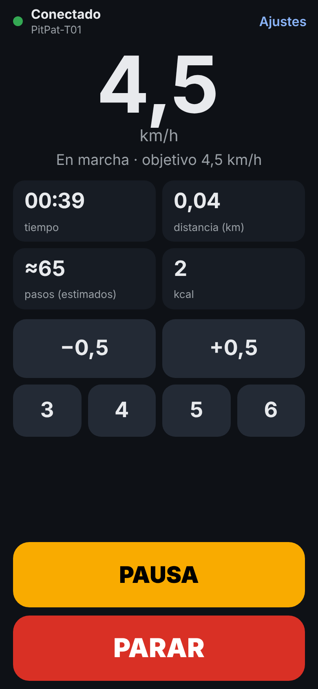
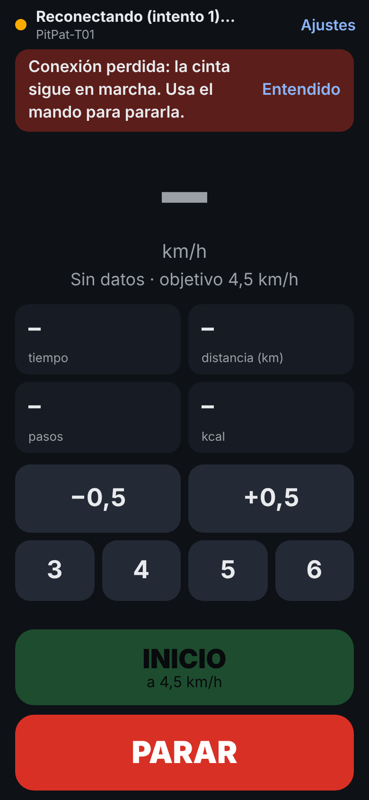

# PitPat Controller

App sencilla, rápida y fiable para controlar por Bluetooth Low Energy (BLE) las cintas de andar que usan la app **PitPat** (nombre Bluetooth `PitPat-T01`). Es una alternativa libre a la app oficial: sin cuentas, sin nube y sin publicidad.

Hay dos versiones, con las mismas funciones y las mismas reglas de seguridad:

- **App Android** (APK): descárgala en [Releases](https://github.com/Franrodr10/pitpat-controller/releases/latest).
- **Versión web**, para **iPhone** (con el navegador gratuito Bluefy) y para Chrome o Edge en Android y en el ordenador: [franrodr10.github.io/pitpat-controller](https://franrodr10.github.io/pitpat-controller/). Mira [Usarla en iPhone](#usarla-en-iphone-versión-web).

> **Estado:** versión 0.1.0 de la app Android, probada con una caminadora PitPat-T01. La versión web reproduce la app con el mismo protocolo, pero aún no se ha probado con la cinta. Los cambios de cada versión están en [`CHANGELOG.md`](CHANGELOG.md).

## Qué hace

- **Se conecta sola** a la última cinta usada al abrir la app, y se reconecta si se corta.
- **Pensada para usarla andando:** velocidad actual en grande, botón INICIO/PAUSA grande, botón rojo de **PARAR siempre visible**, ±0,5 km/h y cuatro velocidades rápidas configurables (3, 4, 5 y 6 km/h por defecto).
- **Métricas en vivo:** tiempo, distancia, pasos y calorías. Si la cinta no informa de los pasos (algunos firmwares envían siempre 0), se estiman a partir de la distancia y se marcan con «≈».
- Pantalla siempre encendida durante la sesión, modo oscuro y textos en español.
- Registro de diagnóstico para compartir si algo falla (Ajustes → Registro de diagnóstico).
- No pide permiso de internet: nada sale del móvil. La versión web tampoco puede conectarse a ningún sitio: su política de seguridad (CSP) solo le deja cargar sus propios archivos.

### Seguridad

- Nunca envía velocidades por debajo de 1,0 km/h ni por encima de 6,0 km/h, ni por encima del máximo que informe la cinta.
- Los cambios de velocidad solo se envían con la cinta en marcha y con datos recientes de ella.
- **PARAR** pasa por delante de cualquier otra orden pendiente, se reintenta si falla el envío y se repite si la cinta sigue moviéndose; si aun así no se confirma, la app avisa y vibra para que uses el mando.
- Si se pierde la conexión, aparece un aviso y el móvil vibra (en iPhone, que no deja vibrar a las webs, suenan tres pitidos). **La cinta sigue en marcha a la misma velocidad** (no tiene parada por pérdida de enlace): usa el mando para pararla.
- Al reconectar **no se reenvía ningún comando**: la app vuelve a leer el estado real de la cinta.

## Capturas

Versión web (la app Android tiene el mismo diseño):

<p>
  
  
</p>

## Cintas compatibles

| Cinta | Nombre BLE | Servicios anunciados | Estado |
|---|---|---|---|
| Caminadora plegable MJWW (AliExpress), 6 km/h, inclinación 6 % | `PitPat-T01` | `0x1910`, `0xFBA0` | ✅ Probada |

Probablemente funcione con otras cintas que se controlan con la app PitPat y anuncian el servicio `0xFBA0` (por ejemplo Superun BA06-B1 o DeerRun), pero no está probado. Algunas cintas que también se anuncian como `PitPat-T01` usan otra variante del protocolo (características `0xFF01`/`0xFF02`); esas no están soportadas de momento.

La inclinación de estas cintas es mecánica, así que la app no la controla.

## Instalar el APK

- **Desde GitHub (recomendado):** abre [la última Release](https://github.com/Franrodr10/pitpat-controller/releases/latest) desde el móvil, descarga el `.apk` y ábrelo. Android pedirá permiso para instalar apps de origen desconocido (solo la primera vez); si Play Protect avisa, elige «Instalar de todos modos».
- **Pasando el archivo:** copia el `.apk` al móvil (cable, Drive, Telegram…) y ábrelo desde el gestor de archivos.
- **Por USB:** con la depuración USB activada en el móvil (Ajustes → Opciones para desarrolladores), `adb install -r pitpat-controller-v0.1.0.apk`. `adb` viene en las platform-tools del SDK.

Cada push compila también un APK de depuración, que queda como artefacto en la pestaña [Actions](https://github.com/Franrodr10/pitpat-controller/actions).

### Permisos

| Android | Permiso | Para qué |
|---|---|---|
| 12 o posterior | Dispositivos cercanos | Buscar la cinta y conectarse. Declarado con `neverForLocation`: la app no deduce tu ubicación. |
| 8 a 11 | Ubicación | Android lo exige para buscar dispositivos Bluetooth; la app no usa la ubicación. En estas versiones la ubicación del móvil debe estar activada mientras se busca la cinta. |
| Todos | Vibración | Avisar si se pierde la conexión. |

## Usarla en iPhone (versión web)

Apple no deja instalar apps fuera de la App Store, y Safari (como el resto de navegadores de iPhone) no permite Bluetooth a las páginas web. La versión web funciona con **Bluefy**, un navegador gratuito de la App Store que sí lo permite:

1. Instala [Bluefy – Web BLE Browser](https://apps.apple.com/app/id1492822055).
2. Enciende la cinta y cierra la app PitPat: la cinta solo admite una conexión.
3. En Bluefy, abre **https://franrodr10.github.io/pitpat-controller/** (guárdala en favoritos).
4. Pulsa **Elegir cinta**, elige `PitPat-T01` en la lista y acepta. Desde ahí se usa igual que la app Android.

Diferencias con la app Android:

- **Cada vez que abras la página** hay que pulsar **Conectar** y volver a elegir la cinta en la lista: la mayoría de los navegadores no dejan que una web se conecte sola a un dispositivo Bluetooth. Mientras la página siga abierta, sí se reconecta sola si se corta.
- **Mantén Bluefy en primer plano y la pantalla encendida.** La página pide al navegador que no se apague la pantalla; si no puede (lo verás en Ajustes), desactiva el bloqueo automático mientras caminas (Ajustes del iPhone › Pantalla y brillo › Bloqueo automático › Nunca).
- **El aviso de conexión perdida suena en vez de vibrar.** Para oír los pitidos, quita el modo silencio del iPhone.

La misma página funciona en Chrome o Edge en Android, Windows, macOS y Linux, sin instalar nada.

## Cómo compilar

Solo hace falta la línea de comandos (no Android Studio): un JDK 17 o superior, `curl` y `unzip`. El script [`tools/setup-android-sdk.sh`](tools/setup-android-sdk.sh) instala el Android SDK (command-line tools, plataforma 37, build-tools y platform-tools); GitHub Actions usa ese mismo script.

```bash
git clone https://github.com/Franrodr10/pitpat-controller.git
cd pitpat-controller
./tools/setup-android-sdk.sh ~/Android/Sdk
export ANDROID_HOME=~/Android/Sdk
./gradlew assembleDebug   # APK en app/build/outputs/apk/debug/app-debug.apk
./gradlew build           # tests, lint y compilación debug y release
./gradlew :core:test      # solo los tests del protocolo
```

GitHub Actions ejecuta `./gradlew build` en cada push, y cada tag `v*` publica el APK firmado como Release ([`docs/RELEASING.md`](docs/RELEASING.md)).

La versión web no se compila: es HTML, CSS y JavaScript sin dependencias, en [`web/app/`](web/app). Para sus tests hace falta Node.js 22:

```bash
cd web
npm ci                # instala Playwright, solo para los tests de extremo a extremo
npm test              # tests del protocolo, las reglas de seguridad y la conexión
npm run test:e2e      # la página en Chromium con una cinta simulada
npm run serve         # sírvela en http://127.0.0.1:8080/app/ y ábrela en Chrome
```

GitHub Actions pasa esos tests en cada push y publica `web/app/` en GitHub Pages con cada push a `main` ([`web.yml`](.github/workflows/web.yml)).

## Arquitectura

```
core/   Kotlin puro, sin Android: el protocolo y las reglas de seguridad, con tests en la JVM
  protocol/TreadmillProtocol.kt   interfaz que describe una familia de cintas
  protocol/PitPatProtocol.kt      implementación PitPat (servicio 0xFBA0)
  protocol/FrameReassembler.kt    junta tramas partidas en varias notificaciones
  control/SessionController.kt    reglas de seguridad: límites y cuándo se envía cada orden
  control/CommandScheduler.kt     cola de órdenes: PARAR primero, la última velocidad gana
  control/StepEstimator.kt        pasos estimados si la cinta no los da
app/    Android
  ble/       permisos, escaneo y conexión GATT (una operación a la vez, en su propio hilo)
  session/   TreadmillManager: conexión, cola de escritura, heartbeat, watchdog y reconexión
  ui/        pantallas en Jetpack Compose
web/    versión web (Web Bluetooth)
  app/js/core/    el mismo protocolo y las mismas reglas que core/, en JavaScript
  app/js/ble.js   selector de dispositivos del navegador y conexión GATT
  app/js/manager.js   como TreadmillManager: cola, heartbeat, watchdog y reconexión
  app/js/ui.js    la página, con el mismo diseño que la app
  test/           los tests de core/ traducidos, tests de la conexión y de extremo a extremo
```

La interfaz solo conoce `TreadmillProtocol` y el estado genérico `TreadmillStatus`; nada fuera de `PitPatProtocol` sabe cómo son las tramas PitPat.

La versión web no comparte código con la de Android (son lenguajes distintos), pero `web/app/js/core/` traduce `core/` archivo por archivo, con los mismos nombres y los mismos tests. **Si cambias una regla de seguridad o el protocolo, cámbialo en los dos sitios.**

## Cómo añadir soporte para otra cinta

1. **Averigua el protocolo.** Con nRF Connect, o con las herramientas de [`tools/`](tools/README.md), apunta los UUID del servicio y de las características, el formato de los comandos y el de las notificaciones de estado.
2. **Implementa `TreadmillProtocol`** en `core/src/main/kotlin/io/github/franrodr10/pitpat/core/protocol/`:
   - `service`, `commandCharacteristic` y `statusCharacteristics`; la app activa notify o indicate según lo que admita cada característica;
   - `advertisedServices` y `namePrefixes`, para reconocerla al escanear;
   - `speedRange`, los límites de velocidad que la app nunca superará;
   - `startFrame`, `speedFrame`, `pauseFrame` y `stopFrame`, que construyen los bytes de cada orden;
   - `keepAliveFrame` (o `null` si no hace falta) y su intervalo;
   - `newDecoder()`, que convierte las notificaciones en `TreadmillStatus`.
3. **Añade tests** en `core/src/test/` con tramas reales capturadas, como hace `PitPatProtocolTest`.
4. **Regístrala** en `SupportedProtocols.all` (`app/src/main/kotlin/io/github/franrodr10/pitpat/session/SupportedProtocols.kt`). El escáner la reconocerá, y el resto de la app (interfaz, cola de órdenes, reglas de seguridad y reconexión) funciona sin cambios.
5. **Versión web:** escribe el mismo protocolo en JavaScript, como `PitPatProtocol` en [`web/app/js/core/pitpat.js`](web/app/js/core/pitpat.js), con sus tests en `web/test/`, y añádelo a `SUPPORTED_PROTOCOLS` en [`web/app/js/protocols.js`](web/app/js/protocols.js). La lista de dispositivos del navegador mostrará las cintas que anuncien sus servicios o nombres.

Para las cintas FTMS estándar (servicio `0x1826`), el estado llega por `0x2ACD` (Treadmill Data) y las órdenes van a `0x2AD9` (Fitness Machine Control Point), que exige pedir el control antes de la primera orden. Habría que añadir a la interfaz ese paso inicial.

## Protocolo y herramientas de prueba

- [`docs/PROTOCOL.md`](docs/PROTOCOL.md): el protocolo BLE de la cinta (UUID, formato de los comandos y de los datos de estado).
- [`tools/`](tools/README.md): una página Web Bluetooth para Chrome en Android y un script Python para el PC con los que probar el protocolo en la cinta, con el procedimiento paso a paso.
- `web/test/support/treadmill-sim.js`: una cinta PitPat simulada que obedece los comandos y envía su estado; la usan los tests de la versión web.

## Créditos

El protocolo de estas cintas lo ha descifrado la comunidad. Este proyecto está escrito desde cero y usa estos proyectos solo como referencia para entender el protocolo (no se ha copiado código):

- [peteh/pacekeeper](https://github.com/peteh/pacekeeper): puente ESP32 para la PitPat-T01 (GPL-3.0).
- [KeiranY/PitPat-WebBT](https://github.com/KeiranY/PitPat-WebBT): control por Web Bluetooth en JavaScript (Unlicense).
- [azmke/pitpat-treadmill-control](https://github.com/azmke/pitpat-treadmill-control): control en Python (MIT).
- [cagnulein/qdomyos-zwift](https://github.com/cagnulein/qdomyos-zwift), carpeta `src/devices/deeruntreadmill/` (GPL-3.0).
- [nicx/pacekeeper-esphome](https://github.com/nicx/pacekeeper-esphome) y [sirfergy/HomeAssistantWalkingPad](https://github.com/sirfergy/HomeAssistantWalkingPad): derivados de pacekeeper (GPL-3.0).

## Aviso

Proyecto no oficial, sin relación con PitPat ni con los fabricantes de las cintas. Una cinta de andar es una máquina con motor: ten siempre a mano el mando físico y úsala bajo tu responsabilidad.

## Licencia

[MIT](LICENSE)
